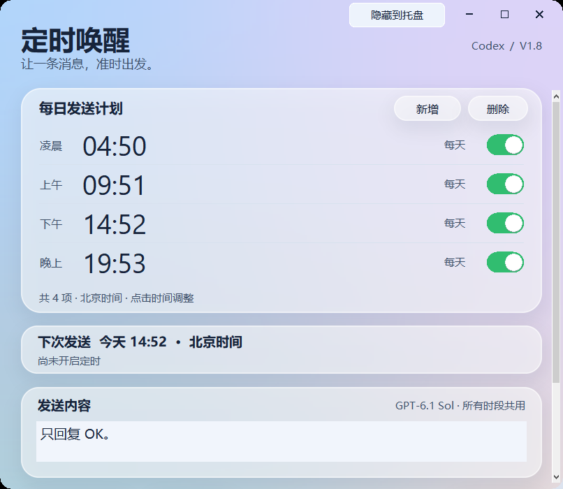

# Codex 定时唤醒

Windows 桌面工具：按每天设定的时间，将自定义消息发送给本机已登录的 Codex。当前版本 **V1.8**。

## 功能

- 每日多个时段，可新增、删除、单独开关，支持滚轮调整时间。
- 默认北京时间 `04:50 / 09:51 / 14:52 / 19:53`，所有时段共用可编辑消息。
- 自动维护专用“定时唤醒”聊天，记录消息提交与模型完成状态。
- 液态玻璃视觉、大字体、可调窗口高度、连续滚动计划列表。
- 隐藏到 Windows 托盘后继续计时，点击图标恢复，右键可显示窗口或退出。

## 使用

1. 先安装并使用 ChatGPT 账号登录 Codex 桌面软件，确认 GPT-6.1 Sol 可用。
2. 下载并运行 [V1.8 EXE](v1_8/dist/Codex定时唤醒_v1_8.exe)；运行 EXE 不需要安装 Python。
3. 核对时间与消息，点击“检查连接”。
4. 可用“立即试发”核对弹窗后发送，再点击“开启定时”。每次启动默认暂停。
5. 保持电脑开机联网；可点击右上角“隐藏到托盘”。

程序只负责定时发送消息，不能直接设置或保证 Codex 的额度重置时间。实际额度以 Codex 显示为准。

## 运行细节

- 使用本机 Codex app-server 接口，与桌面软件共用本地聊天存储；桌面列表可能需要重新进入或刷新后显示新聊天。
- 当前固定选择 `gpt-6.1-sol`，沿用已有 Codex 服务配置。未调用单独的 OpenAI API Key 登录流程。
- 原专用聊天明确拒绝续写、报已被其他连接占用时，会在本次消息提交前新建同名专用聊天；原聊天保留。
- 超时、断连或已提交后的结果不明不会自动重发。
- 睡眠、关机或退出程序期间不能执行；错过超过两分钟的计划会跳过。没有自动唤醒或开机启动功能。
- 修改计划后需要重新开启定时。启动新版前先关闭旧版。
- V1.8 首次尝试继承旧版设置，新设置与记录保存在 `%LOCALAPPDATA%\CodexAlarm\v1_8`，以新快照保存。运行数据不在仓库中。

## 从源码构建

使用 Windows、Python 3.12，以及 Pillow、PyInstaller：

```powershell
python -m pip install Pillow pyinstaller
python v1_8/codex_alarm_v1_8.py
```

打包：

```powershell
powershell -ExecutionPolicy Bypass -File v1_8/build_v1_8.ps1
```

构建脚本会拒绝覆盖已有 EXE。重新构建时请使用新的输出目录或版本名。

## 版本与验证

仓库保留 V1 至 V1.8 的源码、产物与提交历史。请优先使用 V1.8；各版本的使用说明在对应目录。

V1.8 已做本地托盘图标、隐藏后计时器、恢复、退出清理与界面检查。检查中的发送被替换为本地模拟，没有调用真实模型。实际消息发送与额度变化需要用户自行验收。


